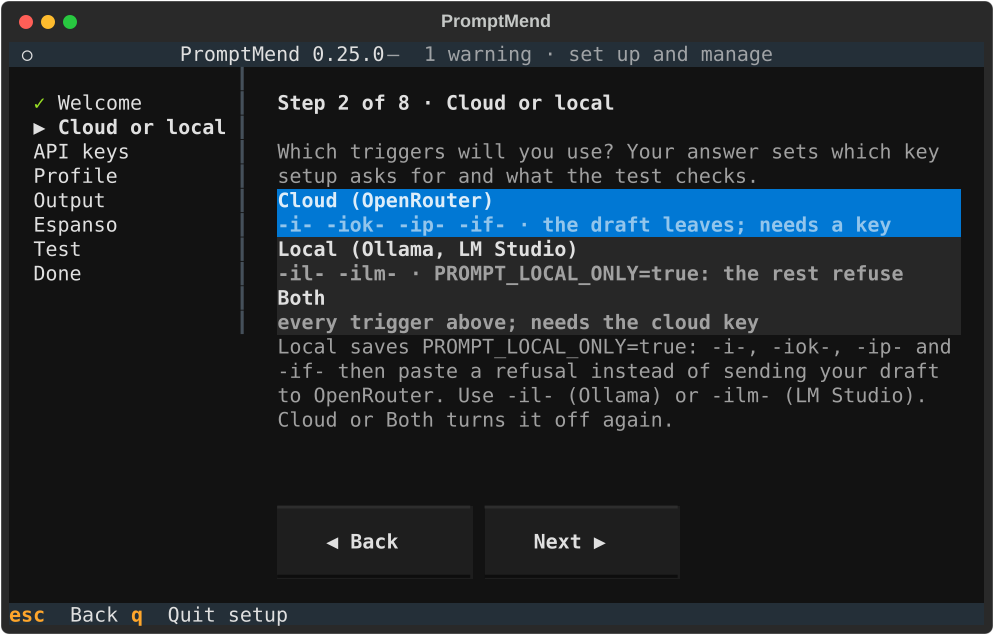
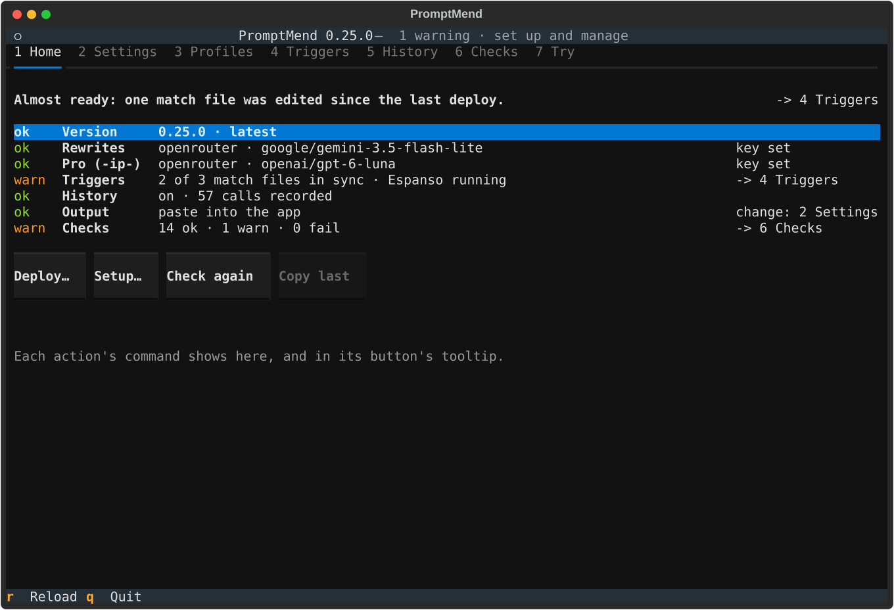
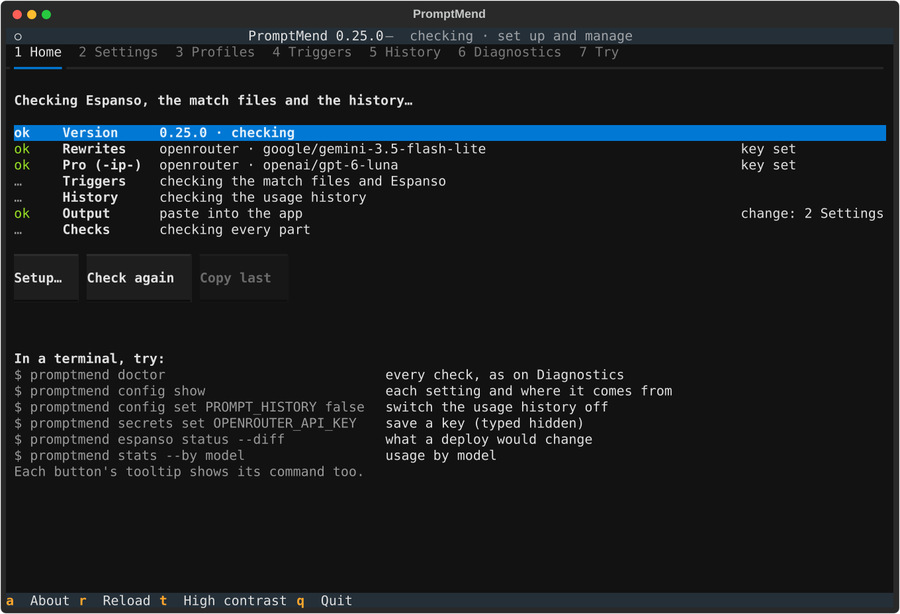
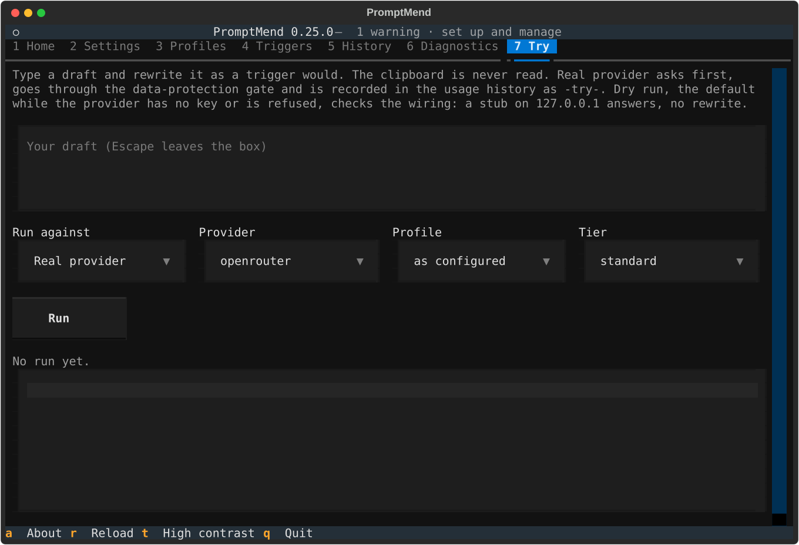

# The interface

`promptmend` opens a full-screen terminal interface for setting up and managing PromptMend:
settings and keys, profiles, the Espanso match files, the usage history, diagnostics, and a
tab to try a rewrite before a trigger pastes one. This page covers its tabs, Home, the
Settings and Try tabs and the keys. Everything it does, a headless command does too (see
[Commands](commands.md)).

## Contents

- [Open it](#open-it)
- [Setup](#setup)
- [Tabs](#tabs)
- [Home](#home)
- [Settings tab](#settings-tab)
- [Copy last](#copy-last)
- [Try tab](#try-tab)
- [Keys](#keys)
- [Accessibility](#accessibility)

## Open it

Run `promptmend` (or `promptmend ui`) in a terminal. Without a terminal, a bare `promptmend`
prints the help and `ui` exits 3.

It opens on Home; each other tab is built the first time you open it, so the first screen
comes up without loading them.

The interface does what the management commands do, through the same code. Keys are shown
only as set or not set. Removing a key, deploying, detaching or deleting history
asks first, in a dialog whose Cancel has the focus. A dialog whose first Enter changes nothing
opens in its field instead: Set key in the hidden value (Enter on it empty changes nothing; a
saved key is replaced only by what you type), Test call, Export, the default profile and
Prune's days (whose Next still asks, on Cancel). No provider
is called except by the Checks tab's Test call button, which runs `improve` against a stub on
`127.0.0.1` with a placeholder key (no command does only that: setup's Test step runs the same
test on your triggers' path), and by a Try tab run you confirm.

## Setup

`promptmend setup` in a terminal opens the interface on its setup, one step at a time, with
the steps listed on the left: `▶` marks where you are, and each step you have passed is
marked as Done lists it: `✓` done, `–` skipped or not run (a test you did not run, a step
`--no-deploy` or `--no-smoke-test` leaves out), `✗` failed or still to do (a key the
triggers need is not set, the match files are not deployed or Espanso's folder was not
found, the test failed), `…` not known yet (the first read of the match folder has not landed; a later re-read
keeps the last result on screen). A step
not reached yet has no mark. The first time you open `promptmend` with nothing set up yet (no
`config.toml`, no key, no match file), it opens by itself, once; Home's "Setup…" opens it any
time.

| Step | What you do |
|------|-------------|
| Welcome | Read what setup does and what the usage history keeps, and which `.env` it no longer reads, if one is left |
| Cloud or local | Say which triggers you will use: cloud (`-i-`, `-iok-`, `-ip-`, `-if-` on OpenRouter), local (`-il-` on Ollama, `-ilm-` on LM Studio) or both. Each choice names the providers its triggers run on with your settings (an Ollama on another computer counts as cloud). Local saves `PROMPT_LOCAL_ONLY=true`, so the cloud triggers paste a refusal instead of sending the draft; the step names them before you press Next. Cloud or both remove `PROMPT_LOCAL_ONLY` again |
| API keys | Paste each key the triggers need (hidden); the step names the triggers each key is for, and after local says that none is needed |
| Profile | Pick the default profile; each line says how it rewrites |
| Output | Paste (the rewrite replaces the trigger) or clipboard (`PROMPT_OUTPUT`: the rewrite waits on the clipboard; see [Output](usage.md#output-paste-or-clipboard)) |
| Espanso | See the match folder and each file in words (not deployed yet, up to date, you edited it), then deploy them; a file you edited is kept |
| Test | Run `improve` against a stub on `127.0.0.1` on the path your triggers take: `-i-`'s for cloud, the first trigger that stays on this computer for local (`-il-`'s on Ollama), both for both; no provider is called, and with no local trigger nothing runs |
| Done | A checklist of what is set and what is left (cloud or local, the profile, the output, the keys), with the command for each, and how to try a trigger your answer leaves you (`-il-` after local, `-i-` otherwise), worded by the output |

Setup never asks for `PROMPT_PROVIDER`: no trigger reads it. It only picks the provider of a
bare `promptmend improve` and the Try tab (the Settings tab shows it under Advanced). On a re-run, local is marked current while `PROMPT_LOCAL_ONLY` is true;
cloud and both are not stored, so neither is marked.

Next and Back (or Escape) move between the steps; Enter on a list picks and moves on. `q`
(Quit setup, in the footer on every step) leaves setup, and so does Escape on Welcome:
opened by `promptmend setup` it exits (code 0, as Done's Quit), opened from Home it goes back
to Home, where a second `q` quits the interface. While a key field has the focus `q` types
into it, so the footer leaves it out there. While the match files deploy or the test runs,
`q` and Escape (Back) are greyed out in the footer and refused, and the Back and Next buttons
do nothing; nothing is queued: press again once it has finished. Each
change is made through the same code as its command and shows that command. With
`PROMPTMEND_ENV` set, settings and keys stay in that file: Next moves on without saving a
choice and says so, the API keys step only says to add each key to that file, and Done names
that file for a missing key or a `PROMPT_LOCAL_ONLY` that does not match your answer.
Otherwise what each step marks current and starts on is what `config.toml` holds (or the
default), not a shell variable (Espanso does not start from your shell), so a plain Next on
every step writes nothing. A choice is written to `config.toml` even when an environment
variable already gives that value, and a choice at its default removes the entry; Done names
an environment variable that overrides your answer, the profile or the output.

Options given to `setup` prefill the wizard: `--use`, `--profile` and `--output` preselect
that choice (Next still saves it), `--deploy` puts the focus on the Deploy button
(nothing is written until you press it), and `--no-deploy` and `--no-smoke-test` leave out
the Espanso and Test steps. The deprecated `--provider` has no step: Welcome says it was not
saved, and without `--use` the Cloud or local step starts on local for Ollama or LM Studio
and on cloud otherwise. `--non-interactive` runs without the wizard and asks nothing
(see [Commands](commands.md#management-commands)).

## Tabs

| Key | Tab | What it shows and does |
|-----|-----|------------------------|
| `1` | Home | Whether you are ready, the most urgent problem and the session log |
| `2` | Settings | What the triggers run, then every setting and key in one list, the rarely changed ones behind an Advanced fold: switch, pick or edit a setting or put it back to its default, set or remove a key (see [Settings tab](#settings-tab)) |
| `3` | Profiles | Built-in and your own profiles; pick the default profile (Set default starts at the highlighted row: one of yours only when a trigger would use it, added or replacing a built-in), edit a profile in `$VISUAL` or `$EDITOR` |
| `4` | Triggers | Each trigger's provider, tier and profile, as the value a call runs with (a value a setting supplies has that setting's name under it, `openrouter` over `PROMPT_PRO_PROVIDER`; a value the trigger's command line names stands alone; `-if-`'s Profile is what its form's `default` choices run, and a profile picked in the form applies instead), the match files and their states (refreshed as soon as a deploy or detach has written the files; `needs Ollama` or `needs LM Studio` when a local trigger's server does not answer), the diff, deploy and detach |
| `5` | History | Usage statistics by trigger, provider, model or day; the last 5 runs in local time (`promptmend history last -n 5`; at 80 and 70 columns the model is cut and the table scrolls sideways); export, prune, reset |
| `6` | Checks | Each provider's model, base URL, key and whether the draft leaves this machine; the settings layers and any problem in the settings files; the `doctor` checks; the Test call, `improve` on a provider you pick against a stub on `127.0.0.1` with a placeholder key |
| `7` | Try | Rewrite a typed draft with a confirmed provider, or check the wiring with a dry run |

The Checks tab was called Diagnostics in 0.27.0 and earlier. All seven tabs fit a 70-column
terminal: below 80 columns the tabs have one space between them instead of two.

Every button's tooltip shows the command that does the same in a terminal, and every result
starts with that command (`$ promptmend config set …`). A button no command does the same as
says what it does instead, and what comes closest: Check again (`promptmend doctor` prints
the same checks), Edit in `$EDITOR` (`promptmend profiles list` shows where each profile is)
and Test call (setup's Test step runs the same test on your triggers' path).

## Home

Home says in one line whether you are ready, or names the most urgent problem and the tab that
fixes it. Below, each row has a status word (ok, warn, FAIL) and the tab that fixes it:

- the installed version and whether it is the latest release (`0.25.0 · latest`); a newer
  one shows as `new` (`0.26.0 available  a: how to update`), and the About screen (`a`)
  gives the update command for your install channel. It is no problem: it never changes the
  headline or the header's status. It asks pypi.org once a day
  ([privacy](privacy.md#update-check)); `PROMPT_UPDATE_CHECK=false` turns it off. The other
  rows never wait for that answer: until it comes, the row says `0.25.0 · checking`, then
  fills in on every tab at once;
- what `-i-` and `-ip-` run (every trigger is listed in [Usage](usage.md#triggers));
- the match files and Espanso;
- the usage history;
- the output mode (`PROMPT_OUTPUT`: paste or clipboard), which the Settings tab switches;
- the `doctor` checks.

The rows are a list with the focus when the interface opens: the arrows move along it, and
Enter (or a click) on a row opens the tab it names; on a `not checked` row it checks again,
as `r` does, and on a newer release it opens About, as `a` does. The digits and `a`, `r`,
`t` and `q` work as everywhere. Leaving Home gives the focus to the tab bar (on the Settings tab its list takes it, as
before); coming back
gives it to the list, on the row it was on, which a reload keeps too.

When the headline names a problem, the first button opens its fix (Tab, then Enter, from
the list), always on the tab the headline points to:

- `Deploy…` when match files are not deployed, out of date or edited, or an older
  deployed `-ip-` needs a redeploy (even when its key is missing: once redeployed it runs on
  `PROMPT_PRO_PROVIDER`, which may need another key): the Triggers tab's deploy preview, as
  its own Deploy button opens it. Nothing is written until you press Deploy in that
  dialog (`promptmend espanso deploy`); it is greyed out until the checks are done, as that
  button is.
- `Set OPENROUTER_API_KEY…` (or the key that is missing): the Settings tab's Set key dialog
  for that key (`promptmend secrets set OPENROUTER_API_KEY`). A missing key is known from
  your settings alone, so this button shows while the other checks still run.
- `Open` and the tab, for anything else.

When no row is a problem (you are ready, or the only rows left are still being checked),
there is no such button, nor when the headline names a row that could not be checked
(`not checked`: no tab fixes it, Check again or `r` tries again).

The row under the highlight is drawn in the highlight's own colours, its status word too, so
it reads in either theme.

The header shows the same status (`ok`, or `1 problem, 2 warnings`). Home also lists this
session's commands; before you have done anything, one line says that they will show there.

Home appears at once, in two steps. The rows that need only your settings (what `-i-` and
`-ip-` run, the output mode) fill in first; the match files and Espanso, the usage history
and the checks need `doctor` and the deploy plan, which can take a moment (Espanso is asked),
so until they are read their rows show `…` and say `checking`, the headline says
`Checking Espanso, the match files and the history…` (without the history when it is off)
and the header says `checking`. Every tab shows the same step, and the whole screen fills in
together when the checks are done, keeping your place (a table's cursor, a field you are
typing in); this happens again after every change and every `r`. If the checks cannot run, those rows say
`not checked` and point to `r`, which tries again. At most three checks run at once: with
Espanso not answering, pressing `r` again and again still shows the settings rows each time,
and the newest press is checked once an earlier check ends. On Windows with Python 3.12 the
interface now gives its background reads their turn (#348); the effect is still to be
measured on a real machine. The exe is built on Python 3.14 from 0.27.0
on, and the Windows uv installs ask for 3.13 or later (see [Windows](install.md#windows)). While a reload reads the rest, the Version row keeps the
answer it already had; it may then say `checking` again until that reload's update check
lands.

Buttons that act on what is still being checked wait for it: Show diff, Deploy and Detach on
the Triggers tab and Prune and Reset on the History tab are greyed out until then (pressed
anyway, they say they wait; nothing is queued to run later), and a first run offers the
setup only once it knows nothing is set up yet. Everything that needs only your settings
(the Settings, Profiles and Try tabs, Home's buttons, Export) works at once.

## Settings tab

The Settings tab (`2`) lists every setting and the three API keys, grouped: Triggers, Output,
Privacy, History, then one group per provider (OpenRouter, Anthropic, OpenAI, Ollama, LM
Studio; OpenRouter shows only with the fold open, as its key and models are under Triggers).
Triggers comes first and answers "what do my triggers run": two lines say what `-i-` and
`-ip-` run (the provider · the model, and `key set`, `key not set`, `refused` or another word
for the key), exactly as Home's Rewrites and Pro rows say it, followed by
`OPENROUTER_MODEL`, `OPENROUTER_PRO_MODEL`, `PROMPT_PRO_PROVIDER` and `OPENROUTER_API_KEY`.
The two lines are not settings: the cursor skips them.

The settings few people change (base URLs, token caps, efforts, temperatures, endpoint pins,
the profile overrides and the like) sit behind the **Advanced** fold, the list's last line
(`▸ Advanced: 29 more settings`). Enter or Space on it shows them below it, each under its
group, and again hides them; the fold stays open or closed while the interface runs (a save, a
reload or another tab keeps it) and starts closed. With the fold closed, the list fits two
screens of an 80x24 terminal when the tab opens. The count on the right says how many
settings are shown (`19 of 48 settings`, or `48 settings` with the fold open).

Each setting's row has a dot, the name, the value and where the value comes
from (`config.toml`, `secrets.toml`, `.env`, `environment` or `default`):

- a filled `●`, in the theme's accent colour, is a value you set: it comes from
  `config.toml`, the secrets file, a `.env` or the environment, even when it is the same as
  the default. A switch you set to off has one too;
- a hollow `○` is the built-in default, which is in effect as it is, or a key that is not set.

Nothing in a row is dimmed because its value is the default: only the word `default` in the
last column is muted. On the cursor row the whole line takes the cursor bar's text colour,
the dot and `default` included. A switch says on or off in its value only. The dot is a glyph
as well as a colour, so it reads in the high-contrast theme and with `NO_COLOR` too. An empty
value is shown as what it does, for example `none`, `not sent` (an effort or temperature),
`any endpoint` (an endpoint pin), `as standard`, `as PROMPT_PROFILE`, `Ollama's own` or `off`
(`PROMPT_GATE_PACKS`). Where an empty value makes the next call fail (a provider, a profile
or a model left empty), it shows `empty`. Keys show only `set` or `not set`, and
`PROMPT_PERSONA` only `<set, hidden>`.
The line under the list explains the setting under the cursor, says where its value comes
from and gives the command that changes it in a terminal; on the fold line, what is behind it.

The list has the focus when the tab opens. Its keys:

| Key | Action |
|-----|--------|
| Up, Down, `j`, `k` | Move |
| Space | Switch a true/false setting, saved at once. On the fold line, show or hide the advanced settings |
| Enter | On the fold line, show or hide the advanced settings. Elsewhere: switch a true/false setting; pick from a list (the current value and the default marked `(current)` and `(default)`); type a value (prefilled, the persona too), checked as the CLI reads it: a rejected value or one that looks like a key stays in the dialog with the reason, and nothing is saved. Both dialogs have a **Use default** button, the same as `u`. On a key's row, the Set key dialog |
| `u` | Back to the default (`config unset`). On a key's row, the Remove key dialog; on the fold line, nothing. Only while the list has the focus |
| `/` | Filter by name or group. The filter searches all 48 settings, the advanced ones too, whether the fold is open or not, and shows the count as `N of 48`; the fold line and the two Triggers lines are hidden while it holds text. Escape clears it and goes back to the list, the fold as it was |

Every change is saved in `config.toml` as `promptmend config set` saves it (keys in the secrets
file), and shows and logs its command (`$ promptmend config set PROMPT_OUTPUT clipboard`,
the persona as `<value withheld>`). An environment variable of the same name still wins, and
the result says so.

## Copy last

Home's **Copy last** sends the session's latest command, exactly as the session log shows it
(withheld values such as `<value withheld>` and placeholders included), to the terminal's
clipboard (OSC 52). Some terminals, tmux or SSH sessions need it allowed, or drop it. The
interface never reads the clipboard.

## Try tab

The Try tab (`7`) rewrites a draft you type into it, the way `-i-` would, so you can see the
result before a trigger pastes one.

1. Type the draft.
2. Pick the provider, the profile, the tier and where it runs (Real provider or Dry run).
   The profile starts at "as configured", which uses `PROMPT_PROFILE` (or `PROMPT_PRO_PROFILE`,
   if set, on the pro tier) exactly as a trigger does. A long profile name is cut in the
   closed picker; its list and the Send dialog show it whole.
3. Press Run. One run at a time.

- **Real provider** first asks, naming the provider, model, base URL and profile ("as
  configured" with the profile it uses); nothing is sent before you confirm. A confirmed
  call may be charged and is recorded in the
  [usage history](privacy.md#usage-history) as a direct call with the trigger `-try-`, so
  `stats` tells it from `promptmend improve` typed in a terminal. Home's session log shows it
  with the draft withheld.
- **Dry run** only checks the wiring: a stub on `127.0.0.1` answers with a fixed
  reply (`promptmend setup check: ok`) to a placeholder key, so no provider is called, nothing
  is rewritten and nothing is recorded. The line above the result starts with
  `Dry run (checks the wiring, no rewrite)`, and the report says so too.

Where it runs starts at Real provider when the picked provider can be used: its API key is
set, or it needs none (Ollama, LM Studio), and `PROMPT_LOCAL_ONLY` does not refuse it.
Otherwise it starts at Dry run. It follows the provider you pick until you choose where it
runs yourself; your choice then stays, also after a reload.

The clipboard is never read or written, and the draft never goes into a command line. The
settings are read as a trigger reads them, so an invalid one stops the run with its marker.

Every run goes through the [data-protection gate](privacy.md#the-data-protection-gate): a
draft the gate blocks shows the same `[promptmend: …]` marker a trigger would paste, and
nothing is sent. A dry run is gated (and refused under `PROMPT_LOCAL_ONLY`) exactly as the
real call would be.

Under the result, a line gives the time, the requests, the tokens in and out and the cost: as
reported, `unknown` when the provider did not say, or `not applicable` for a dry run and local
models, never a made-up 0.

## Keys

| Key | Action |
|-----|--------|
| `1`-`7` | Switch tabs |
| `a` | About: version, whether a newer release exists and the command to update, install channel, folders and licence |
| `r` | Reload |
| `u` | In the Settings list: back to the default (`config unset`) |
| `t` | Switch to the high-contrast theme |
| `q` | Quit |
| Escape | Leave the Try tab's draft, so the tab keys work again; clear the Settings filter |
| Up, Down, Enter | Move in [Home's rows](#home) and open the tab a row names |
| Up, Down, `j`, `k`, Space, Enter, `/` | Move and change in the [Settings list](#settings-tab) |

A digit switches tabs wherever the focus is on the tab you leave (a button, a table, a
picker), except while you type in the Settings filter or the Try tab's draft, where it is
typed. Home and Settings give the focus to their list as they open. On the other tabs, a focus
you leave on the old tab moves to the tab bar; when nothing had the focus (after Escape in the
draft, say), nothing has it on the new tab either.

The footer shows the keys of the tab you are on, Reload and Quit. `a` and `t` are left out of
it, so Quit fits a 70-column terminal; they work on every tab, the Settings list included, but
not while you type in the Settings filter or the Try tab's draft (letters go into the text;
the footer then shows only Escape), and not on a dialog, About or the setup wizard. While a
picker's list is open it takes letters and digits (type to search), so `a`, `t`, `q`, `r` and
the digits do nothing until Escape closes it; on About, `a` closes About.

## Accessibility

- `t` switches to a high-contrast theme.
- `NO_COLOR` turns colour off.
- Scripts and screen readers can use the headless [commands](commands.md) instead: each tab's
  action names its command.

## See also

- [Commands](commands.md): the headless commands behind every button
- [Install](install.md#set-up): `setup` and `setup --non-interactive`
- [Troubleshooting](troubleshooting.md): what the Checks tab's checks mean
